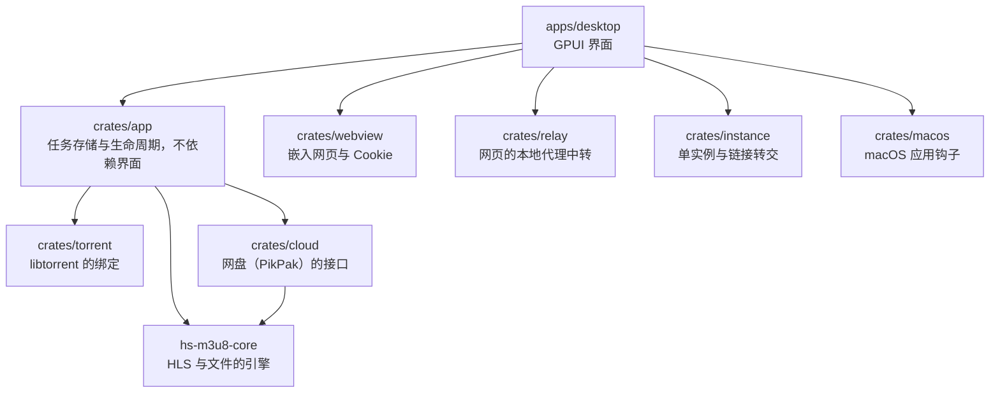

<p align="center">
  
</p>

<h1 align="center">hs-dlx</h1>

<p align="center">以视频为中心的桌面下载器：贴一个地址或网页，挑清晰度，下点播、录直播。</p>

<p align="center">
  <a href="https://github.com/x-haose/hs-dlx/releases/latest"></a>
  <a href="https://github.com/x-haose/hs-dlx/actions/workflows/check.yml"></a>
  
  
  <a href="LICENSE"></a>
</p>

<p align="center">
  <a href="#下载安装">下载安装</a> ·
  <a href="#功能">功能</a> ·
  <a href="#路线图">路线图</a> ·
  <a href="#技术栈与结构">技术栈与结构</a> ·
  <a href="#从源码构建">从源码构建</a> ·
  <a href="CHANGELOG.md">更新日志</a> ·
  <a href="CONTRIBUTING.md">参与开发</a>
</p>

hs-dlx 是用 Rust 写的原生桌面应用，界面用 GPUI 直接绘制，不是 Electron，也不是套在网页里的壳。现在支持 HLS（m3u8）
的点播与直播录制、在网页里找视频流、多连接分段下载文件、磁力链接与种子文件（含做种、诊断与网络检测），都能断点续传；
HLS 输出 MP4 或可直接播放的本地 HLS；磁力链接也能交给你自己的 PikPak 账号云离线，再取回本机。HLS 与文件的下载引擎是
[hs-m3u8](https://github.com/x-haose/hs-m3u8) 的核心库，BT 用 libtorrent。接下来会加入更多网盘、边下边播与站点解析，
见[路线图](#路线图)。

<p align="center">
  
</p>

<table>
  <tr>
    <td width="50%"></td>
    <td width="50%"></td>
  </tr>
  <tr>
    <td align="center">下载中</td>
    <td align="center">完成</td>
  </tr>
</table>

## 下载安装

到 [Releases](https://github.com/x-haose/hs-dlx/releases/latest) 下载对应平台的安装包：

| 平台 | 安装包 | 要求 |
|---|---|---|
| macOS | `hs-dlx_<版本>_aarch64.dmg` | macOS 11 及以上，Apple 芯片 |
| Windows | `hs-dlx_<版本>_x64-setup.exe` | Windows 10 / 11 x64；装在当前用户下，不要管理员。嗅探页用系统的 WebView2 |
| Linux | `hs-dlx_<版本>_amd64.deb` | 在 Ubuntu 24.04 上构建；依赖 WebKitGTK 4.1、GTK 3 |

安装包没有代码签名，第一次打开时：

- **macOS**：提示「已损坏」或「无法验证开发者」时，把应用拖进「应用程序」后执行
  `xattr -dr com.apple.quarantine /Applications/hs-dlx.app`。
- **Windows**：SmartScreen 拦下时点「更多信息 → 仍要运行」。
- **Linux**：`sudo apt install ./hs-dlx_<版本>_amd64.deb`。托盘图标走 StatusNotifierItem，纯 GNOME 要装
  AppIndicator 扩展才显示。

每个版本附 `SHA256SUMS`，下载后可校验：`shasum -a 256 -c SHA256SUMS --ignore-missing`。

## 功能

**下载 HLS**

- 粘贴 m3u8 地址即探测：几档清晰度与码率、音轨、时长、预估大小；同心环上 ↑ ↓ 换档，回车开始。
- 点播与直播录制。TS 与 fMP4 分片、AES-128 加密、独立音轨都支持；合并成 MP4 不重新编码，也可以存成可直接播放的本地
  HLS，或两者都要。
- 断点续传：暂停、退出应用、断网后都能接着下，只补缺的分片。
- 直播录制的钟面按时间显示录到了哪些时段、哪里缺了；随时停止并写出已录的部分，不联网也能写出。

**下载文件**

- 粘贴的地址是文件时显示大小、类型与能否续传；服务器支持时多个连接分段并行下载、断点续传，限制连接数时自动减少。
- 第一次请求核对是不是之前看到的那个文件：链接过期、登录失效后换成的错误页不会被当成文件下完。

**磁力与种子**

- 粘贴磁力链接，或点粘贴栏的「种子文件」打开 `.torrent`：取到种子信息后列出文件，勾选要下的再开始。
- 自动补公共 tracker（[ngosang/trackerslist](https://github.com/ngosang/trackerslist)，经设置里的代理取），DHT 不通时
  也多一条找节点的路；私有种子不补，补的不存进任务，每次开始时补当时的列表。
- 连着的节点凑不齐全部内容时标「资源不足」，写明能凑齐多少；tracker 报错时写明原因。
- 暂停、退出后接着下；上次没正常退出的，继续时先校验已下的文件，不会把没写完的当成下好的。
- 下完接着做种，默认分享率到 1.0 或做满 24 小时停，可改为不做种或一直做；可限上传速度。
- 下得慢时一键诊断：监听、路由器端口映射、运营商内网、DHT、tracker、公共 tracker 与种子的人数，逐项写明结论与能做的事。
- 可让 BT 经 SOCKS5 代理（节点、tracker 与 DHT 都经它）：运营商限制 UDP、DHT 连不上时用；默认直连。很多代理服务禁止
  BT，开之前先看清它的条款。
- 网络检测（设置里）：约 10 秒查直连与经 BT 代理的 DHT、UDP 的 tracker、IPv6、端口映射与外部连入，写明是哪里不通、
  该不该开 BT 代理；只发握手类的包，不带任何种子的信息。

**云离线（PikPak）**

- 设置里登录你自己的 PikPak 账号：在系统浏览器里登录并确认，应用不经手密码。
- 磁力链接点「改用 PikPak 云离线」：网盘替你下完（网盘里已有的即秒完成），再多连接分段取回本机、能续传，每个文件按网盘
  给的哈希（GCID）校验。本机 DHT 不通、找不到节点时尤其有用。
- 网盘只能整包离线，取回也是整包；放弃任务只删本机已取回的，不动网盘里的文件。
- 接口是非官方的，有违反服务条款、被封号的风险；大陆网络多半要经代理才连得上 PikPak。

**粘贴什么都行**

- m3u8 地址、网页地址、文件地址、磁力链接；浏览器开发者工具里「复制为 cURL」的整条命令（地址、请求头与 Cookie 一起
  带上）；迅雷 `thunder://`、QQ 旋风 `qqdl://`、快车 `flashget://` 链接。

**在网页里找视频流**

- 粘贴的是网页地址时，在后台打开网页找出里面的视频流，标好清晰度、时长与是否直播。
- 要登录、或要点了播放才加载的网页，打开网页弄好后，找到的流会列出来。
- 下载时带上网页存下的 Cookie 与来源地址，按同站与 SameSite 规则决定带哪些。

**网络与出错**

- 代理：跟随系统、直连，或指定 HTTP、HTTPS、SOCKS 代理；嗅探页的网页走同一个出口。
- 请求头：新建时可加；遇到 401、403 时改请求头后重试。
- 失败按种类说明原因与能做的事：改请求头再试、改存本地 HLS、写出已录的、稍后重试。

**外观**

- 日蚀与血月两套外观；窗口背景是动态的日冕与网格，下载时随速度流动。系统要求减少动态效果时动画都停下。

<p align="center">
  
</p>

**桌面集成**

- 关窗后在托盘里继续下载；任务都停下前退出会先问。
- 单实例：从别处再打开带链接的 hs-dlx，链接交给已打开的窗口。
- 顶栏显示保存目录所在盘的可用空间。
- 自动更新（macOS 与 Windows）：启动时与之后每天查一次新版本，安装包验过发布签名（minisign）才装，装好后退出并打开新
  版本；Linux 提示到下载页。

**不支持**

- DRM 保护的内容（Widevine、PlayReady、FairPlay 等）：遇到即明确报错，不会尝试绕过。

## 路线图

方向是围绕视频做深：找得到、下得完、马上能看；普通文件、磁力与云离线也在同一个应用里下。

| 版本 | 内容 |
|---|---|
| 0.6 | **以任务为中心与插件**：一个链接从粘贴起就是一个任务，自己往下走、要处理时停下等，可同时粘贴多个；粘贴任何地址都走同一个入口自动认出；本机 WebSocket 控制接口；插件系统（yt-dlp 是第一个插件） |
| 0.7 | **浏览器扩展**（接管下载、列出网页里的视频）、兼容 aria2 的 JSON-RPC；**批量下载**（多行粘贴、导入列表、地址模板、播放列表与频道整批下）；下载队列、全局限速、计划任务、按类型分目录 |
| 0.8 | **边下边播与远程**：边下边播；手机等设备用浏览器控制、观看、传到手机；无界面运行（NAS、Docker） |
| 0.9 | **视频深度**：DASH（点播与直播）、多音轨与字幕、MKV、只下一段、直播回看、去广告、HTTP-FLV 直播录制 |
| 0.10 | **搜索插件**：插件可以提供视频与磁力搜索，搜到即下或边下边播；搜索插件在独立的仓库，应用本身不带任何资源 |

穿插在各版之间：115、迅雷云离线；英文界面；只下音频。

## 技术栈与结构

| 层 | 用的什么 |
|---|---|
| 界面 | [GPUI](https://gpui.rs/)（经 gpui-kit），GPU 直接绘制 |
| 嵌入网页 | [wry](https://github.com/tauri-apps/wry)：macOS 用 WKWebView，Windows 用 WebView2，Linux 用 WebKitGTK |
| 下载引擎 | [hs-m3u8](https://github.com/x-haose/hs-m3u8) 的核心库（Rust、tokio）；BT 为静态链接的 [libtorrent](https://libtorrent.org) |
| 合并 MP4 | 静态链接的精简 FFmpeg，只做转封装，不需要另装 |
| 存储 | SQLite（随应用编译） |
| 打包 | cargo-packager：dmg、NSIS、deb |



依赖只朝箭头方向：`crates/app` 不认识任何界面框架，各平台 crate 互不依赖、只由界面组合。这些规则由
`scripts/check_deps.sh` 在检查里强制。

## 从源码构建

要 Rust（版本见 `rust-toolchain.toml`）、[uv](https://docs.astral.sh/uv/)、CMake、Ninja 与 Perl；Linux 上另要
WebKitGTK 4.1、GTK 3、xkbcommon 与 fontconfig 的开发包。

```sh
make ffmpeg          # 编译静态链接的精简 FFmpeg（只需一次）
make libtorrent      # 编译 BT 引擎用的 libtorrent 与 OpenSSL（只需一次，要 CMake、Ninja、Perl）
cargo run -p hs-dlx  # 运行
make check           # 全部检查
make package         # 本机平台的安装包
```

各平台的准备、检查项、分支与发版流程见 [CONTRIBUTING.md](CONTRIBUTING.md)。

## 使用须知

请只下载你有权下载的内容，并遵守所在地的法律与网站的服务条款。hs-dlx 不提供任何资源，也不内置资源搜索。云离线以第三方
客户端的方式接入（用 PikPak 安卓客户端的公开参数调它的接口），用的是你自己的账号，与这些服务没有关联。

## 许可证

[MIT](LICENSE)。安装包里静态链接与随带的第三方软件（含 LGPL-2.1 的 FFmpeg）的声明见
[apps/desktop/LICENSES](apps/desktop/LICENSES)，装好后在设置页的「第三方声明」里也能打开。
